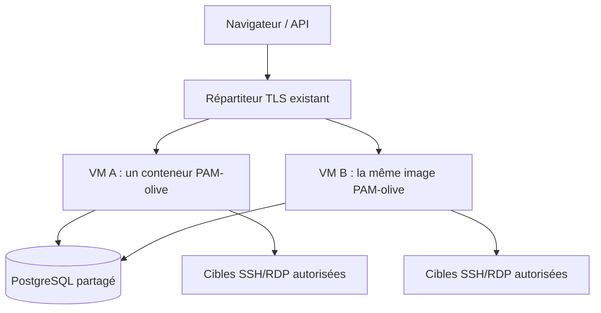

# Deux instances actives : déploiement et qualification

## Une image, un conteneur applicatif par VM

Le serveur ne nécessite pas une pile de dix conteneurs : chaque VM exécute **la même image PAM-olive**, avec son Web, son traitement des tâches et son moteur PAM privé. PostgreSQL reste externe. Le répartiteur TLS existant envoie des requêtes aux deux VM ; il n'est pas nécessaire d'ajouter Redis, un worker ou un moteur Guacamole en conteneurs séparés pour le runtime actuellement livré.

La cible d'architecture prévoit également Redis pour les données éphémères et les futurs contrats de tâches. Le runtime qualifié ici utilise encore PostgreSQL pour ses sessions, transactions et baux ; ce test ne clôt pas le travail d'intégration Redis ni la qualification de son éventuelle topologie HA.



Ce schéma est une topologie, pas la preuve que les VM, le répartiteur ou PostgreSQL sont eux-mêmes hautement disponibles. L'installation de démonstration reste à une instance ; le test décrit plus bas utilise deux instances **temporaires** et une base séparée.

## Ce qui doit être identique — et distinct

Sur les deux VM :

- la même image, épinglée par digest, les mêmes modules et catalogues signés ;
- la même `DATABASE_URL` et les mêmes paramètres TLS, le même fuseau ;
- les mêmes `SECRET_KEY` et `PAMOLIVE_ENCRYPTION_KEY`, conservées hors du dépôt ;
- la même origine publique, les mêmes listes d'hôtes et origines CSRF ;
- des règles de cibles, de proxy et de collecte réseau cohérentes ;
- **des `PAMOLIVE_INSTANCE_ID` différents**, par exemple `vm-a` et `vm-b`.

Le `compose.yml` ordinaire est exécuté une fois sur chaque VM. Ne pas lancer les migrations dans chaque démarrage : retirer toutes les instances du trafic, sauvegarder la base et les clés, migrer une seule fois, puis démarrer la nouvelle image partout. Les mises à niveau mélangées/rolling ne sont pas qualifiées.

Les [sessions Django sont conservées en base](https://docs.djangoproject.com/en/5.2/topics/http/sessions/#using-database-backed-sessions), pas en mémoire du nœud. Les compteurs MFA et codes de récupération sont verrouillés dans PostgreSQL ; une connexion supplémentaire ne doit pas réautoriser un code consommé ailleurs. Les tâches sont réclamées ou rendues idempotentes par les transactions, révisions et jetons de fencing PostgreSQL. Deux processus de tâches peuvent tourner en même temps : aucun résultat d'autorisation n'est mis en cache pour permettre la bascule.

## Contrôler deux VM existantes

Avant de placer les deux VM derrière le répartiteur, lancer le contrôle depuis un poste disposant de Python 3.8 ou plus et d’OpenSSH. Les deux VM Linux doivent déjà exécuter la même image contenant le module `deploy.remote_ha_node`. Le compte SSH d’exploitation doit pouvoir inspecter et utiliser le socket Docker local `/var/run/docker.sock` sur chaque VM. Valider les empreintes des hôtes dans le fichier `known_hosts` avant l’essai : le contrôle refuse les connexions interactives et les hôtes SSH inconnus.

```sh
python -m deploy.check_remote_active_active --node-a lab-pam-a --node-b lab-pam-b
```

Remplacer les alias d’exemple par ceux du poste. Les options `--ssh-config`, `--project` et `--container` permettent de sélectionner la configuration SSH et le projet Compose PamOlive. La sonde refuse un conteneur non sain, non Web ou hors du projet indiqué. Elle contrôle les images, les identifiants des hôtes, les identifiants applicatifs, les versions, les migrations et la cohérence des clés et de la politique de sécurité. Le rapport n’affiche ni les valeurs ni les empreintes des clés, ni les adresses de la base.

Pour vérifier que les deux nœuds atteignent réellement le même PostgreSQL, A prend un verrou aléatoire dans une transaction en lecture seule. B ne doit pas pouvoir l’obtenir tant que A le tient ; il doit ensuite l’obtenir après la fin de la transaction de A. Le verrou ne cible aucune table métier. Il disparaît à la fin de la transaction, même si le poste perd la connexion. La sonde n’exécute ni migration ni redémarrage.

Un succès confirme la cohérence observée à cet instant. Il ne valide pas la répartition du trafic, la perte d’une VM, la reprise de PostgreSQL ou la tenue en charge. Effectuer ces essais séparément sur l’infrastructure de test.

## Répartition et connexions PAM

Le proxy transmet l'hôte public, termine TLS et **écrase** les en-têtes d'origine uniquement depuis ses adresses explicitement autorisées. Il doit permettre les [mises à niveau WebSocket](https://nginx.org/en/docs/http/websocket.html), ne pas rejouer les POST après un envoi incertain et retirer un backend qui échoue à son contrôle de disponibilité.

`/health/` contrôle actuellement une lecture PostgreSQL et renvoie 200 ou 503, sans détail interne. Ce n'est pas un contrôle complet de capacité, de dérive des clés, de version de schéma, ni de l'état de toutes les dépendances. La commande `python -m deploy.check_runtime` complète le contrôle local du Web, des tâches et de l'isolation du moteur natif. Un déploiement HA doit également superviser ces processus et la disponibilité du répartiteur et de PostgreSQL.

Une requête HTTP suivante peut arriver sur l'autre VM. Un WebSocket déjà établi reste en revanche attaché à son processus et à son moteur natif. **La perte de ce nœud interrompt sa session SSH/RDP ; elle ne migre pas une connexion TCP native vers l'autre VM.** Le contrôle et le réconciliateur clôturent les baux orphelins et marquent les captures partielles. La reprise exige une nouvelle ouverture autorisée ; aucune session n'est rejointe silencieusement et aucune MFA n'est injectée au milieu d'un transport encore ouvert.

Le ticket de lancement n'est pas un secret d'affinité du répartiteur : il est partagé et consommé une seule fois en base. Une commande d'arrêt peut être déposée sur une autre instance ; le propriétaire du transport la détecte lors de son contrôle continu. Les tests natifs séparés couvrent ces contrôles et le fencing ; le test HTTP ci-dessous ne revendique pas encore un scénario PAM multi-conteneurs.

## Qualification reproductible, sans données d'installation

Prérequis : Docker Compose, Python 3.8+ pour le pilote, une image déjà construite et une base **dédiée** `test_pamolive_ha` appartenant au rôle de qualification. Cette base ne doit contenir aucune donnée métier à conserver. Le pilote ne la crée ni ne la supprime. Sa préparation SQL relève de l'administrateur PostgreSQL ; ne jamais donner `CREATEDB` au rôle applicatif uniquement pour lancer ce test.

Depuis une copie du dépôt, générer un environnement privé avec l'outil fourni. `DATABASE_URL` désigne ici la connexion source à partir de laquelle l'outil conserve l'hôte et les options TLS mais remplace **uniquement** le nom de base. Il ne change aucune base et refuse les paramètres susceptibles de détourner ce nom.

```sh
python -m deploy.prepare_active_active_environment /chemin/prive/ha.env --image pamolive-platform:qualification --network reseau-prive-postgresql
python -m deploy.check_active_active --env-file /chemin/prive/ha.env
```

Sous Windows, utiliser `py -m ...` et un chemin privé Windows ; sur un NAS, `python3 -m ...` et au besoin `--docker /usr/local/bin/docker`. Ne pas publier le fichier généré. L'outil de préparation peut aussi s'exécuter dans l'image avec le répertoire de sortie privé monté ; le pilote Docker, lui, s'exécute sur l'hôte, sans montage du socket Docker dans un conteneur.

Le projet Docker est fixé à `pamolive-platform-ha-check`. Deux conteneurs temporaires, sans volume métier et avec des ports aléatoires liés à `127.0.0.1`, démarrent avec les mêmes clés **fictives**. Les fixtures refusent une base qui n'est pas explicitement dédiée, puis vérifient aussi `current_database()` pour empêcher une divergence entre nom logique et destination réelle. Le projet doit être absent avant le test : un projet existant n'est jamais arrêté ou réinitialisé automatiquement.

Le pilote vérifie successivement :

1. Les deux runtimes actifs utilisent la même image et passent leur contrôle d'isolation.
2. Une connexion locale avec TOTP sur A devient utilisable sur B, sans nouvelle authentification.
3. Le même TOTP est refusé sur B ; un code de récupération envoyé simultanément aux deux nœuds est consommé exactement une fois.
4. La MFA récente personnelle autorise une modification sur B ; désactivation et réactivation d'un module deviennent visibles sur l'autre nœud.
5. Un changement d'organisation effectué sur A s'applique sur B, où un objet de l'autre organisation reste introuvable.
6. Un même événement source envoyé simultanément aux deux nœuds donne un seul fait et un seul identifiant.
7. Les deux processus de tâches révoquent un droit arrivé à échéance une seule fois, avec une seule incrémentation de révision et une preuve d'audit.
8. Le nœud A est tué brutalement ; la session authentifiée et une nouvelle écriture fonctionnent sur B.
9. A redémarre et accepte la session existante ; les faits, révocations et chaînes d'audit partagés sont vérifiés.

Le pilote retire ensuite ses deux conteneurs et son réseau temporaire, jamais le réseau de base externe ni une base PostgreSQL. Il conserve les données synthétiques dans la base dédiée. En échec, des journaux privés sont conservés dans un dossier temporaire annoncé ; ne pas les publier sans revue. Une expiration d'observation n'est pas une autorisation de relancer un deuxième test sur le même projet.

## Limites de la preuve

Un succès démontre une bascule **HTTP/applicative** entre deux conteneurs du même hôte. Il ne qualifie pas la panne physique d'un hôte, la partition réseau entre VM, le failover PostgreSQL, le répartiteur TLS, le débit sous charge ou une reprise native SSH/RDP sans interruption. Ces portes doivent être exécutées sur l'infrastructure cible avant une annonce de HA de production. La latence de stockage et les délais de sécurité PAM restent ceux documentés dans [les transports PAM](pam-transport.md) ; aucun délai ou contrôle n'est assoupli pour ce test.
