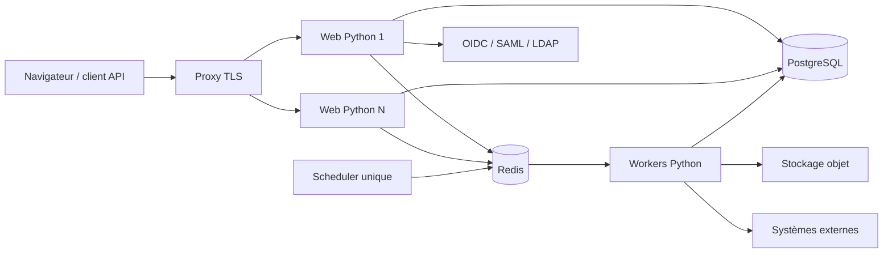

# Architecture cible de PAM-olive Platform

> Statut : **proposition V1 à valider avant reprise du développement**.
> Cette architecture ne reprend aucun code Odoo. Elle reprend seulement une expérience modulaire et une navigation familière aux utilisateurs d’un ERP.

## 1. Objectif

PAM-olive Platform vise la **gouvernance universelle des accès**, centrée sur l’identité. Elle rapproche les accès numériques et physiques des humains, prestataires, machines, services, workloads, applications et certificats avec leur justification métier. IAM et PAM constituent deux domaines de cette plateforme modulaire.

Tout accès doit pouvoir être expliqué par six dimensions : **Qui ? Quoi ? Où ? Quand ? Comment ? Pourquoi ?** Le noyau fournit les services transverses ; les fonctions métier sont livrées sous forme de modules indépendants, communautaires ou commerciaux.

L’[atlas visuel autonome](architecture-platform.html) documente cette vision, les flux métier et les frontières techniques. Il s’agit d’une architecture cible, pas d’un inventaire des capacités actuellement déployées.

La [référence fonctionnelle](product-vision.md) précise les objets, les huit scénarios et les critères d’acceptation de cette vision.

La première version privilégie un **monolithe modulaire Python**. Cette forme réduit la complexité opérationnelle, garantit les transactions PostgreSQL et permet d’extraire un service plus tard sans commencer par une architecture distribuée prématurée.

### Modèle fonctionnel universel

Le modèle sépare cinq couches : gouvernance, intention d’accès, observation, corrélation/analyse et réponse/preuves.

- Le **graphe d’identités** relie acteurs, comptes, certificats, appareils, ressources et contexte métier ; les relations sont typées, datées, sourcées et isolées par organisation.
- L’**Access Intent** exprime un périmètre d’intervention : acteur, ressources, méthode, droits, validité, raison et approbation.
- L’**Access Event** décrit un fait observé, avec sa source, l’heure de l’événement et de réception, le résultat et les preuves disponibles.
- L’**évaluation** compare droits, intentions et observations. Elle conserve les règles utilisées et distingue fait confirmé, écart et donnée inconnue.
- La **réponse** peut alerter ou investiguer. Bloquer ou révoquer nécessite une capacité explicite du connecteur et une politique autorisée.

Ces capacités sont des domaines métier modulaires ; elles ne sont pas ajoutées aux responsabilités du noyau technique. PostgreSQL conserve leurs données autoritatives. Le graphe peut commencer par des tables de nœuds/relations et des projections, sans introduire immédiatement une base supplémentaire.

## 2. Principes non négociables

1. Le noyau ne contient aucune règle métier IAM, PAM ou IGA.
2. Un compte de connexion n’est pas une identité métier.
3. Toutes les données métier sont rattachées à une organisation.
4. PostgreSQL est la source de vérité ; Redis ne contient que des données temporaires.
5. Aucun secret exploitable n’est stocké en clair dans PostgreSQL.
6. Une requête Web ne télécharge ni n’installe jamais du code Python.
7. Désactiver un module ne supprime aucune donnée.
8. Toute mutation sensible produit un événement d’audit et un événement transactionnel.
9. Le noyau communautaire reste utilisable sans licence commerciale.
10. Les extensions commerciales ne sont jamais présentées comme techniquement « impossibles à modifier ».

## 3. Architecture logique



### Composants

| Composant | Responsabilité | État conservé |
|---|---|---|
| Proxy TLS | TLS, routage, limites de requêtes, en-têtes de sécurité | Non |
| Web Python | Interface, API, authentification, transactions métier | Non |
| PostgreSQL | Données du noyau et des modules, audit, outbox | Oui |
| Redis | Cache, verrous courts, files de tâches, sessions optionnelles | Temporaire |
| Worker | Synchronisations, connecteurs, rapports, tâches longues | Non |
| Scheduler | Déclenchement périodique ; une seule instance logique | Non |
| Stockage objet | Exports, pièces jointes et enregistrements volumineux | Oui |

Le Web et les workers sont réplicables. Les migrations sont exécutées une fois par livraison, avant la bascule des instances Web.

## 4. Découpage du code

```text
pamolive_platform/
  kernel/                 démarrage, configuration et registre
  core/
    organizations/        organisations et appartenances
    accounts/             comptes de connexion et MFA
    authorization/        rôles techniques et permissions
    modules/              paquets détectés et activations
    audit/                journal append-only et chaîne d’intégrité
    events/               outbox transactionnelle
    jobs/                 suivi des tâches asynchrones
    licensing/            entitlements des extensions commerciales
  modules/                modules communautaires livrés avec le dépôt
  web/                    coque ERP, menus et composants communs
  api/                    API publique versionnée
```

Les extensions commerciales sont distribuées séparément et ne sont pas stockées dans le dépôt public du noyau. La frontière proposée pour une logique commerciale indépendante est un service séparé relié par API et événements publics, sans import ni héritage du code AGPL. Un plugin Python chargé dans le même processus ne bénéficie pas automatiquement de cette indépendance ; une exception ou une licence adaptée doit couvrir ce cas avant distribution.

## 5. Frontières du noyau

Le noyau possède uniquement :

- les organisations ;
- les comptes capables de se connecter à PAM-olive ;
- l’appartenance d’un compte à une organisation ;
- les permissions techniques et leur attribution ;
- l’authentification locale, MFA et fédérée ;
- le registre des paquets et leur activation par organisation ;
- les paramètres typés et références de secrets ;
- l’audit, les événements et les tâches ;
- les informations de licence et d’entitlement.

Le noyau ne possède pas les identités RH, applications gérées, groupes métier, cibles PAM, coffres, demandes d’accès ou campagnes de recertification. Ces objets appartiennent à leurs modules.

## 6. Multi-organisation

Le schéma supporte plusieurs organisations dès la V1, même si une installation n’en utilise qu’une.

- Le compte est global à l’installation.
- Une appartenance relie le compte à une organisation.
- Les rôles sont attribués à l’appartenance, jamais directement au compte.
- Chaque requête métier possède un `organization_id` résolu depuis la session ou le jeton.
- Les services rejettent toute opération croisant deux organisations.
- Les contraintes uniques incluent `organization_id` lorsque la donnée est organisationnelle.

Une future isolation physique par base reste possible, mais n’est pas nécessaire pour la V1.

## 7. Communications entre modules

Les modules communiquent par deux mécanismes :

1. **Service Python versionné** pour une opération synchrone dans la même transaction ;
2. **Événement outbox versionné** pour une réaction asynchrone et rejouable.

Un module ne doit pas importer les modèles internes d’un autre module. Les références croisées utilisent un identifiant UUID stable et le contrat de service public du module propriétaire.

Exemple : le module Approbations conserve le type et l’UUID d’une demande d’accès, mais ne modifie jamais directement les tables du module IAM.

## 8. Sécurité

- MFA et fédération sont fournies par le noyau et s’appliquent à tous les modules.
- Les permissions suivent `module.ressource.action`.
- Les actions sensibles déclarent une exigence de MFA récente.
- Les secrets sont remplacés par des `secret_ref` pointant vers le keyring ou un coffre externe.
- Les événements d’audit sont chaînés par empreinte et rendus non modifiables au niveau applicatif et PostgreSQL.
- Les tâches possèdent une clé d’idempotence.
- Les appels sortants passent par une politique commune anti-SSRF.
- Les modules sont chargés au démarrage depuis une liste autorisée ; aucun import Python arbitraire depuis l’interface.

## 9. Disponibilité

La V1 supporte deux topologies :

- **simple** : un Web, un worker, un scheduler, PostgreSQL et Redis ;
- **HA** : plusieurs Web et workers, proxy répartiteur, PostgreSQL/Redis hautement disponibles et un scheduler avec verrou distribué.

L’état d’une instance Web n’est jamais local. Les sessions, verrous et tâches doivent survivre au remplacement d’un conteneur.

## 10. Décisions à approuver

Avant la reprise du code, les décisions suivantes doivent être acceptées :

- monolithe modulaire Django/Python pour la V1 ;
- PostgreSQL 16+ obligatoire en production ;
- Redis obligatoire dès qu’un worker ou plusieurs nœuds sont utilisés ;
- UUID pour les identifiants métier publics ;
- multi-organisation dans le schéma dès le départ ;
- séparation compte de connexion / identité métier ;
- API publique versionnée `/api/v1/` ;
- installation de code uniquement pendant un déploiement contrôlé ;
- activation fonctionnelle possible depuis l’interface ;
- noyau AGPL et modules commerciaux distribués séparément.
