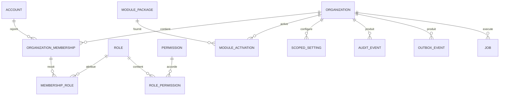
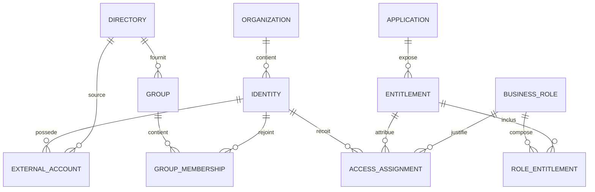

# Schéma de données cible V1

> Statut : proposition à valider. Les noms sont les noms logiques ; les tables PostgreSQL utilisent les préfixes `core_`, `iam_`, `pam_`, etc.

## Conventions

- identifiants métier : UUID v7 lorsque disponible, sinon UUID v4 ;
- dates : `timestamptz` en UTC ;
- suppression métier : archivage explicite, pas de suppression silencieuse ;
- métadonnées : `jsonb` uniquement pour les extensions non structurantes ;
- toutes les tables organisationnelles portent `organization_id` ;
- contraintes uniques et index commencent par `organization_id` ;
- aucune clé, mot de passe ou jeton exploitable dans une colonne texte ;
- les migrations d’un module restent propriétaires de ses tables.

## Noyau

### Tables du noyau

| Table | Colonnes principales | Contraintes essentielles |
|---|---|---|
| `core_organization` | `id`, `key`, `name`, `status`, `default_locale`, `created_at` | `key` unique |
| `core_account` | `id`, `username`, `email`, `password_hash`, `status`, `last_login_at` | username et email normalisés uniques |
| `core_organization_membership` | `id`, `organization_id`, `account_id`, `status`, `joined_at` | unique `(organization_id, account_id)` |
| `core_role` | `id`, `organization_id`, `key`, `name`, `is_system` | unique `(organization_id, key)` |
| `core_permission` | `id`, `code`, `module_key`, `description` | `code` unique |
| `core_role_permission` | `role_id`, `permission_id` | paire unique |
| `core_membership_role` | `membership_id`, `role_id`, `valid_from`, `valid_until` | rôle et appartenance dans la même organisation |
| `core_module_package` | `key`, `version`, `core_spec`, `manifest_hash`, `license_kind`, `signature_status` | unique `(key, version)` |
| `core_module_activation` | `organization_id`, `package_id`, `status`, `configuration`, `activated_at` | une activation courante par organisation/module |
| `core_scoped_setting` | `organization_id`, `namespace`, `key`, `value_json`, `secret_ref` | unique `(organization_id, namespace, key)` |
| `core_license_entitlement` | `organization_id`, `module_key`, `edition`, `limits`, `not_before`, `expires_at`, `signature` | signature vérifiée avant activation commerciale |
| `core_audit_event` | `id`, `organization_id`, `sequence`, `occurred_at`, `actor_account_id`, `action`, `subject_type`, `subject_id`, `request_id`, `source_ip`, `payload`, `previous_hash`, `event_hash` | append-only ; unique `(organization_id, sequence)` |
| `core_outbox_event` | `id`, `organization_id`, `topic`, `schema_version`, `aggregate_type`, `aggregate_id`, `payload`, `created_at`, `published_at` | création dans la transaction métier |
| `core_job` | `id`, `organization_id`, `module_key`, `kind`, `status`, `idempotency_key`, `attempts`, `scheduled_at`, `started_at`, `finished_at`, `result`, `error_code` | unique `(organization_id, idempotency_key)` |

## Séparation compte / identité

`core_account` représente une personne ou un service autorisé à se connecter à PAM-olive. Une identité gérée par l’IAM peut exister sans compte PAM-olive ; inversement, un opérateur PAM-olive peut administrer plusieurs organisations sans être une identité gouvernée dans chacune.

Le lien facultatif entre les deux est porté par le module IAM, pas par le noyau.

## Premier module proposé : IAM Foundation

| Table | Rôle |
|---|---|
| `iam_identity` | personne, service ou identité technique gouvernée |
| `iam_directory` | source autoritative ou annuaire connecté |
| `iam_external_account` | compte d’une identité dans un système externe |
| `iam_group` | groupe provenant d’un annuaire ou géré localement |
| `iam_group_membership` | appartenance datée d’une identité à un groupe |
| `iam_application` | application dont les accès sont gouvernés |
| `iam_entitlement` | droit fin exposé par une application |
| `iam_business_role` | rôle métier composant plusieurs droits |
| `iam_role_entitlement` | composition d’un rôle métier |
| `iam_access_assignment` | droit effectif, daté et traçable d’une identité |

Les demandes et décisions n’appartiennent pas à IAM Foundation : elles seront la propriété du module Approbations. Les campagnes périodiques appartiendront au module Recertification.

## Évolutions prévues sans casser le noyau

### Objets de la gouvernance universelle

Les objets suivants appartiennent à leurs domaines métier, jamais aux tables du noyau. Leur schéma détaillé sera arrêté avant leurs migrations.

| Objet | Responsabilité et champs structurants |
|---|---|
| `GraphNode` | référence à l’objet propriétaire, type (identité, compte, certificat, appareil, ressource, fournisseur, contexte métier), organisation |
| `GraphRelation` | source et destination, relation typée, période de validité, provenance, confiance, organisation ; projection des données propriétaires |
| `AccessIntent` | acteur et compte éventuel, ressources, méthode, privilèges, contexte métier, validité, état, référence d’approbation |
| `AccessEvent` | identifiant externe dédupliqué par source/organisation, début source, fin observée facultative et réception, acteur résolu ou inconnu, compte/certificat, ressource, action, lieu, méthode, résultat, référence de preuve |
| `BusinessContext` | ticket, incident, changement, maintenance, projet ou urgence ; justification, source, propriétaire, statut et période de validité |
| `SupplierContract` | fournisseur, sponsor, intervenants, période, ressources, méthodes, horaires/fuseau, zones et restrictions |
| `AccessEvaluation` | événement, intention(s) rapprochée(s), politique et versions, constats, preuves, incertitude, risque et statut de traitement |
| `ResponseAction` | évaluation, action proposée/autorisée, capacité de connecteur, cible, clé d’idempotence, résultat et preuve |

Le certificat est un objet gouverné de premier rang, distinct de son propriétaire et de sa machine. Il porte émetteur, empreinte, dates et usages ; une observation sur un nouvel hôte constitue un signal à vérifier.

Les événements d’accès ne remplacent pas le journal d’audit du noyau : l’un conserve les faits provenant des systèmes connectés, l’autre conserve les opérations et décisions de la plateforme. Les données brutes, enrichissements et évaluations restent séparés afin de permettre une réévaluation sans réécrire les preuves.

- module `approvals` : demandes, étapes, décisions, délégations ;
- module `connectors` : synchronisations et provisioning ;
- module `pam` : cibles, politiques, sessions et élévations ;
- module `vault` : références de secrets, rotations et leases ;
- module `recertification` : campagnes, attestations et révocations ;
- module `reporting` : projections et exports sans devenir source de vérité.

## Écarts du prototype historique

Le prototype initial présentait les écarts suivants. Ils décrivent son état avant la refonte organisationnelle, pas les limites actuelles du code publié ; voir l’[état réel de l’implémentation](implementation-status.md).

1. ses clés primaires sont numériques au lieu d’UUID ;
2. il ne possède pas d’organisation ;
3. il confond utilisateurs connectés et identités gouvernées ;
4. les rôles métier sont actuellement dans le noyau ;
5. l’audit ne possède ni séquence ni chaîne d’intégrité PostgreSQL ;
6. le registre ne sépare pas paquet installé et activation par organisation.
