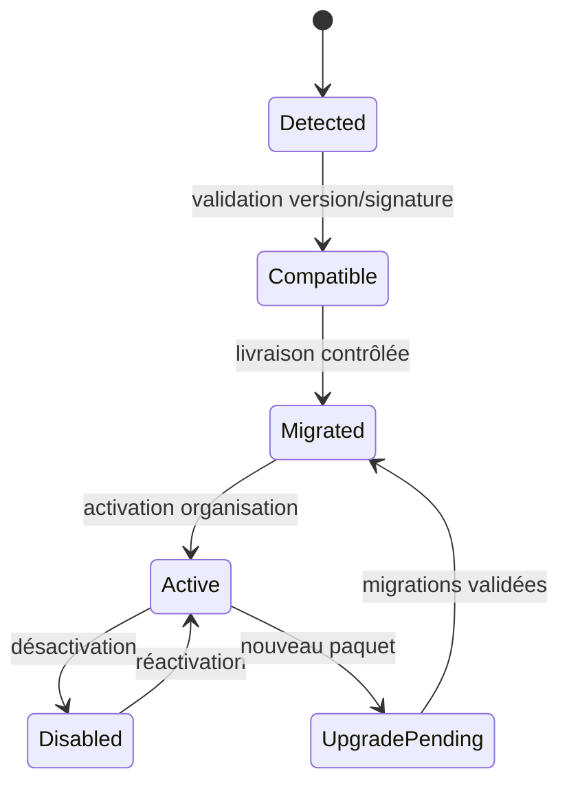

# Contrat des modules PAM-olive V1

> Statut : proposition à valider avant le développement du premier module.

## 1. Deux opérations distinctes

- **Installer un paquet** ajoute du code Python pendant une livraison contrôlée.
- **Activer un module** rend ses fonctions disponibles pour une organisation depuis l’interface.

L’interface Web ne lance jamais `pip`, ne décompresse pas de code et n’importe pas un chemin fourni par un utilisateur. Cela transformerait l’administration des modules en exécution de code à distance.

## 2. Format d’un paquet

Un module est un paquet Python installable qui expose un point d’entrée `pamolive.modules`. Il peut vivre dans le dépôt communautaire ou dans un dépôt commercial séparé.

```text
pamolive_module_approvals/
  pyproject.toml
  pamolive_module_approvals/
    manifest.py
    apps.py
    api.py
    services.py
    events.py
    urls.py
    migrations/
    templates/
    static/
    tests/
```

Exemple de point d’entrée :

```toml
[project.entry-points."pamolive.modules"]
approvals = "pamolive_module_approvals.manifest:module"
```

## 3. Manifeste immuable

```python
ModuleManifest(
    key="approvals",
    name="Approbations",
    version="1.0.0",
    core_spec=">=1.0,<2.0",
    api_version="1",
    license_kind="community",
    dependencies=(ModuleDependency("iam", ">=1.0,<2.0"),),
    permissions=(
        Permission("approvals.request.create"),
        Permission("approvals.decision.approve", sensitive=True),
    ),
    menus=(MenuItem("approvals.inbox", route="approvals:inbox"),),
    emitted_events=("approvals.request.approved.v1",),
    consumed_events=("iam.access.requested.v1",),
)
```

Champs obligatoires : clé, nom, version SemVer, plage de versions du noyau, version du contrat API, type de licence, dépendances, permissions, menus et événements.

Le noyau calcule l’empreinte du manifeste et conserve l’état de validation de la signature du paquet.

## 4. Cycle de vie



La suppression physique d’un module et de ses tables n’est pas proposée dans l’interface V1.

## 5. Contrats autorisés

Un module peut :

- appeler les services publics versionnés du noyau ;
- publier un événement via l’outbox dans sa transaction ;
- consommer des événements avec un gestionnaire idempotent ;
- enregistrer des routes sous son espace de nom ;
- déclarer des menus, permissions, tâches et contrôles de santé ;
- posséder ses modèles et migrations PostgreSQL.

Un module ne peut pas :

- importer les modèles privés d’un autre module ;
- modifier les tables appartenant à un autre module ;
- remplacer le middleware d’authentification du noyau ;
- stocker un secret en clair ;
- créer des permissions à la volée depuis une requête ;
- charger du JavaScript distant non approuvé.

## 6. Interface utilisateur

Le noyau fournit la coque de navigation, les composants de listes, formulaires, recherches, notifications et actions. Un module fournit uniquement ses pages et déclarations de menus.

La V1 utilise des vues serveur Django et une couche JavaScript légère. Une SPA globale n’est pas requise. Le module doit rester utilisable avec les composants standard du noyau et respecter les couleurs PAM-olive.

## 7. Permissions et actions sensibles

Chaque vue et chaque service déclarent une permission. Une permission sensible impose une MFA récente suivant la politique personnelle et organisationnelle.

```text
iam.identity.view
iam.identity.manage
approvals.decision.approve
pam.session.terminate
vault.secret.reveal
```

La vérification existe dans la couche service, pas uniquement dans le bouton de l’interface.

## 8. Événements

Le nom contient une version : `iam.identity.created.v1`. Le payload inclut au minimum :

- `event_id` ;
- `organization_id` ;
- `occurred_at` ;
- `actor_account_id` si disponible ;
- `aggregate_id` ;
- `correlation_id` ;
- données propres au schéma versionné.

Un consommateur conserve les identifiants déjà traités afin de supporter les doublons.

## 9. Modules communautaires et commerciaux

Le manifeste annonce `community` ou `commercial`.

- Un module communautaire est distribué avec une licence open source compatible.
- Un module commercial est livré comme paquet signé depuis un canal privé.
- L’activation commerciale vérifie un entitlement signé, hors ligne si nécessaire.
- L’expiration d’une licence interdit les nouvelles opérations commerciales mais ne détruit et ne rend jamais inaccessibles les données du client.

## 10. Tests obligatoires

Chaque module fournit :

- tests de compatibilité avec la version minimale et maximale du noyau ;
- migrations ascendantes et, lorsque possible, réversibles ;
- tests de séparation des organisations ;
- tests de permissions côté service ;
- tests d’idempotence des événements et tâches ;
- tests vérifiant qu’une désactivation conserve les données ;
- inventaire logiciel et vérification des dépendances.
