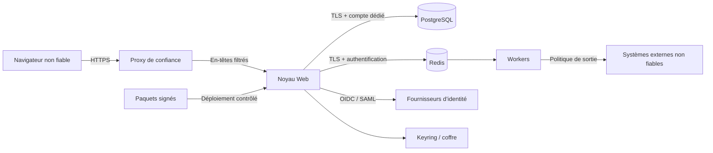

# Frontières de sécurité et modèle de menace V1

> Statut : proposition à valider avec l’architecture. Ce document décrit les garanties attendues du noyau ; il ne remplace pas une revue de sécurité avant publication.

Le périmètre effectivement livré et ses limites figurent dans [l’état d’implémentation](implementation-status.md). Le [transport PAM SSH](pam-transport.md) précise ses contrôles opérationnels, les captures, la séparation des utilisateurs système et la porte de qualification RDP encore fermée.

## 1. Actifs à protéger

- comptes de connexion, facteurs MFA et sessions PAM-olive ;
- identités, appartenances, rôles, droits et décisions d’accès ;
- références de secrets, jetons de connecteurs et clés de signature ;
- journaux d’audit, preuves d’approbation et historique des changements ;
- tâches asynchrones et événements d’intégration ;
- paquets de modules et entitlements commerciaux ;
- données appartenant à chaque organisation.

## 2. Frontières de confiance

Règles de frontière :

1. le navigateur, les fournisseurs d’identité et les systèmes connectés sont toujours considérés comme non fiables ;
2. le proxy supprime les en-têtes d’identité entrants et ne recrée que ceux explicitement autorisés ;
3. PostgreSQL, Redis et le coffre ne sont jamais exposés directement à Internet ;
4. les workers utilisent la même couche de permissions et les mêmes services métier que le Web ;
5. un paquet de module n’entre dans la zone de confiance qu’après contrôle de provenance, compatibilité et signature ;
6. une licence commerciale autorise une fonction mais ne rend jamais du code non fiable digne de confiance.

## 3. Menaces prioritaires et contrôles

| Menace | Exemple | Contrôles V1 obligatoires |
|---|---|---|
| Croisement d’organisation | lire ou modifier l’identité d’un autre client en changeant un UUID | `organization_id` injecté par le contexte authentifié, filtrage dans les services, contraintes PostgreSQL, tests négatifs systématiques |
| Élévation de privilèges | appeler directement une API sans passer par le bouton masqué | permission vérifiée dans le service métier, refus par défaut, audit du refus |
| Vol ou rejeu de session | cookie intercepté ou ancien jeton MFA réutilisé | cookies `Secure`, `HttpOnly`, `SameSite`, rotation de session, expiration, anti-CSRF, anti-rejeu TOTP |
| Contournement de MFA récente | exécuter une action sensible via worker ou API | exigence portée par le contrat de service, preuve d’authentification datée et liée à la session ou au jeton |
| Falsification de l’audit | modifier ou supprimer une décision | table append-only, séquence par organisation, chaîne de hachage, sauvegarde externe et vérification périodique |
| Injection de tâche | publier une commande arbitraire dans Redis | files authentifiées/TLS, messages signés ou strictement sérialisés, liste fermée de types de tâche, validation côté worker |
| SSRF par connecteur | demander au serveur d’appeler une adresse interne | résolution et validation centralisées, blocage des plages privées/métadonnées, liste d’hôtes autorisés, nouvelle validation après redirection |
| Fuite de secret | secret client stocké dans un formulaire ou un log | `secret_ref`, masquage, redaction des logs, réponses en écriture seule, rotation |
| Compromission de module | paquet Python malveillant | aucune installation Web, canal privé contrôlé, empreinte/signature, revue, SBOM ; un module Python reste du code de confiance |
| Rejeu d’événement | même événement traité deux fois | `event_id`, clé d’idempotence, contrainte unique chez le consommateur |
| Course concurrente | deux approbations ou deux rotations simultanées | transaction, verrou ciblé, version optimiste, opérations idempotentes |
| Contournement de licence | modification locale du noyau open source | la licence n’est pas une frontière de sécurité ; signature d’entitlement, distribution privée, valeur portée par mises à jour et services |

## 4. Isolation des organisations

L’isolation ne repose jamais uniquement sur un filtre ajouté dans une vue.

- Le contexte d’organisation est construit à partir de l’appartenance authentifiée, jamais d’un champ libre du formulaire.
- Les services exigent explicitement ce contexte.
- Les identifiants UUID évitent l’énumération facile mais ne constituent pas un contrôle d’accès.
- Les relations entre objets organisationnels vérifient qu’ils appartiennent à la même organisation.
- Les tâches et événements transportent `organization_id`, mais le worker revalide l’existence et l’autorisation avant la mutation.
- Les tests de chaque module tentent des lectures, écritures, exports et traitements asynchrones croisés.

Une défense PostgreSQL supplémentaire par Row-Level Security pourra être activée après preuve qu’elle reste compatible avec les migrations, les workers et les tâches d’administration. Elle ne remplace pas les contrôles applicatifs.

## 5. Actions sensibles

Une action est sensible lorsqu’elle permet de prendre le contrôle d’un compte, d’accéder à un secret, d’altérer une preuve, d’élargir des droits ou d’interrompre une session active. Exemples V1 :

- modifier les méthodes MFA, fournisseurs OIDC/SAML ou politiques de connexion ;
- attribuer un rôle administrateur ou une permission critique ;
- révéler, exporter, faire tourner ou déléguer un secret ;
- approuver un accès privilégié ou contourner une séparation des tâches ;
- lancer, reprendre, transférer ou terminer une session PAM ;
- modifier les règles d’audit, de rétention, les clés de signature ou les destinations d’export ;
- activer un module commercial ou modifier une configuration de connecteur capable d’écrire.

La MFA récente est demandée avant l’ouverture d’une session SSH/RDP ou avant l’action administrative. Elle n’interrompt jamais une session SSH/RDP déjà ouverte. La durée de fraîcheur est configurable par utilisateur parmi les valeurs autorisées par la politique de l’organisation ; l’organisation peut imposer une durée maximale, pas affaiblir le minimum de sécurité du produit.

Dans l’alpha actuelle, les valeurs personnelles sont 2/5/10/15 minutes ; le plafond organisationnel n’est pas encore implémenté. Réduire ses propres privilèges en fermant son relais ne nécessite pas de MFA, même après expiration de cette fraîcheur.

## 6. Disponibilité et reprise

- Le Web reste sans état local et supporte plusieurs instances actives.
- PostgreSQL est la source de vérité et bénéficie de sauvegardes testées, d’un objectif de reprise et d’un plan de restauration.
- Redis peut être reconstruit ; aucun audit ni décision métier n’y réside exclusivement.
- Le scheduler utilise un verrou avec bail renouvelable pour éviter un double déclenchement.
- Une tâche perdue ou rejouée ne doit pas produire un second effet grâce à l’idempotence.
- Les migrations sont séparées du démarrage des instances et disposent d’une procédure de retour applicatif compatible avec le schéma.

## 7. Exigences avant publication

- matrice des permissions du noyau revue ;
- tests d’isolation multi-organisation et tests adverses automatisés ;
- analyse des dépendances, SBOM et verrouillage reproductible ;
- secrets de développement absents de l’historique Git ;
- en-têtes de sécurité, limites de requêtes et politique CSP testés ;
- restauration PostgreSQL testée sur un environnement vide ;
- signature des paquets et entitlements documentée ;
- procédure de signalement des vulnérabilités publiée.

## 8. Risques acceptés en V1

- Les modules Python ont les privilèges du processus : ils doivent être traités comme du code de confiance et non comme des plug-ins isolés.
- L’isolation physique par base ou instance n’est pas fournie automatiquement ; elle reste une option de déploiement pour les clients qui l’exigent.
- La chaîne de hachage détecte une altération mais n’empêche pas à elle seule un administrateur de base tout-puissant d’effacer les données ; l’export vers un stockage externe immuable complète le dispositif.
